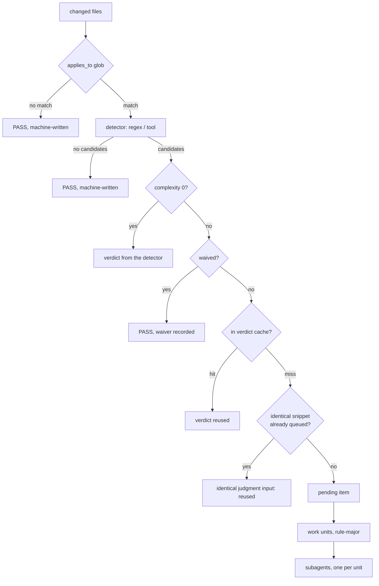
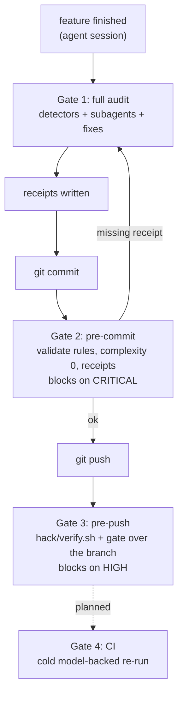

<!--
SPDX-FileCopyrightText: 2026 Deutsche Telekom AG

SPDX-License-Identifier: CC0-1.0
-->

# Code auditor architecture

An LLM cannot be made deterministic. A harness around it can be made to behave
deterministically almost all of the time, and — more importantly — to fail
loudly rather than silently when it does not.

Three ideas carry the whole design.

**Take the model out of search.** "Find the violations in this diff" is an
unbounded search and unbounded searches do not repeat. "Here is one snippet,
does it break this one rule" is a closed question and closed questions mostly
do. Scripts find candidates; the model only judges them.

**Trust nothing the model writes.** Every verdict must quote source that is
re-matched against the audited Git blob, every pending item must be answered, and the
audit is rejected outright if either fails. The same standard applies to the
rules themselves: an example that claims to come from this repository is
re-read from the pinned revision and rejected if it does not match.

**Measure it.** Sourced examples double as fixtures, judged with the example
itself held out of the prompt. A rule that misclassifies its own fixtures, or
whose verdict flips between runs, fails the model-backed selftest. Automated
model-backed CI enforcement is planned, not installed.

## The funnel

Cost and variance both scale with the number of *candidates*, not with the
number of rules. Adding the 101st rule costs a glob test and a regex scan on
every change where it does not fire.



Measured on this repository, on a 34-file change against 5 rules that planted
six deliberate violations: 7 candidates, 20 items, **4 work units**. Four of
the five rules were narrowed or settled without a model. Re-running after a
fix returns cached verdicts for everything untouched, so the second pass needs
no subagents at all.

## Determinism levers

| Lever | What it removes |
| --- | --- |
| Deterministic candidate generation | the model choosing what to look at |
| Frozen context window | run-to-run variation in what the model sees |
| Atomic checks, one closed question each | compound judgments that drift |
| `### Violation` / `### Allowed` examples | unanchored interpretation of the rule |
| Provenance on every example | examples invented to fit the rule |
| Detector must match its own examples | rules that can never fire |
| Rule-major work units, no shared context | one rule's reasoning bleeding into the next |
| Candidate-major packing inside a unit | the same context re-sent per check, unrelated files sharing a prompt |
| Packing by sorted (file, line) | prompt contents depending on arrival order |
| `report_scope: changed` by default | inheriting a file's pre-existing backlog |
| `>` markers on changed lines | a model unable to tell the change from its surroundings |
| Severity-scaled batch size | precision loss where it is expensive |
| Evidence re-anchored against the file | hallucinated findings |
| Completeness gate | silent partial audits |
| Content-addressed cache | re-judging what has not changed |
| Clustering | the same snippet getting two different answers |
| `UNCLEAR` as a first-class verdict | the model guessing to avoid a gap |

## Identity

Everything is keyed on content, never on a timestamp or a run id.

```
item_id     = sha256(rule_id, check_slug, file, normalized_anchor)
judgment_key = sha256(file, normalized_anchor, numbered_context, detector_detail)
verdict_key  = sha256(rule_content_hash, judgment_key + check_slug, model)
receipt_key  = sha256(version, file, blob_sha, rule_content_hash, model, changed_lines, tree_hash)
```

Context includes change markers. File-scoped judgments receive the complete
file. Receipts are only written for applicable paths, and the tree hash binds
package and other cross-file inputs. This conservative dependency scope can
require re-auditing after an otherwise unrelated file changes. Changing or
removing the selected judge pin also invalidates the last audit.

Detectors run in an isolated complete snapshot: the index for staged audits,
committed blobs for the push gate, and frozen working-tree files for session
audits. Evidence is verified against the recorded blobs, not later edits.
The branch comparison base comes from the default target branch, never from
the feature branch's tracking ref.

This single decision buys four properties at once:

- **caching** — unchanged snippet, unchanged rule, same answer
- **incrementality** — editing a rule invalidates only that rule's entries
- **commit receipts** — see below
- **self-expiring waivers** — the id contains the snippet, so changing the code
  retires the waiver automatically

## Gates

The model never runs inside a git hook. Hooks have no credentials, no network
budget and no patience. Instead the hook verifies a **receipt**: for every
staged blob and every rule that applies to it, an entry must exist under the
current rule text. Change a file after auditing and its blob changes, the
receipt disappears, the gate blocks. It is a hash lookup, so it costs about as
much as `gitleaks`.



| Gate | Cost | Model | Blocks on |
| --- | --- | --- | --- |
| 1 — session | 20–60 s | yes | nothing, it reports |
| 2 — pre-commit | < 1 s | no | `CRITICAL` |
| 3 — pre-push | seconds | no | `HIGH` |
| 4 — CI (planned) | not installed | yes | intended: `HIGH` |

Thresholds tighten as the change travels. A gate people learn to bypass in the
first week never recovers, so commit-time stays cheap and narrow.

## Escape hatches

Deliberate, visible, and all three leave a trace.

| Situation | Mechanism |
| --- | --- |
| Finding is wrong or accepted | `.agents/auditignore`, keyed by item id, expires when the code changes |
| Work in progress | `AUDIT_GATE=off git commit` |
| Emergency | `git commit --no-verify`; a normal push still runs Gate 3 |

Gate 3 is installed by `pre-commit install` as a Git pre-push hook, so it
applies to terminal pushes and every agent harness. Bypassing both local
hooks currently has no model-backed CI backstop.

A detector tool that is not installed is **not** an escape hatch: it produces
an engine error. A check that cannot run must never look like a check that
passed.

## Known limits

- A sweeping refactor that genuinely trips many rules is genuinely expensive.
  Clustering absorbs most of it, because wide refactors are repetitive.
- Complexity 2 rules read whole files and are the least repeatable part of the
  system. Keep them rare and keep their checks narrow.
- The verdict cache trusts a previous judgment of identical frozen inputs.
  The planned cold CI audit will not reuse local verdicts.
- Leave-one-out is stricter than production, where the example *is* in the
  prompt. That is deliberate: the gap between the two is exactly the amount of
  the verdict that rests on recognising the example instead of applying the
  rule.
