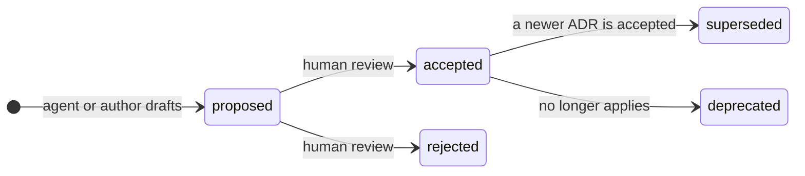
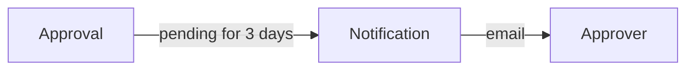

# ADR format

An ADR records one decision for two readers: a person on the documentation
site, and an agent deciding whether a change fits. Both need the same three
things: why a choice was needed, what was chosen, and what lost. Everything
else lives in the architecture pages, and the ADR links there.

Create the file with `adr.py new "Title" --domain <dir>`; it picks the next
number and writes the skeleton. `adr.py validate` enforces everything below
that a script can check.

## Frontmatter

| Key | Required | Meaning |
| --- | --- | --- |
| `title` | yes | The decision as a short statement, in double quotes: "Domains talk through shared resources". |
| `status` | yes | `proposed`, `accepted`, `rejected`, `superseded` or `deprecated`. You only ever write `proposed`. |
| `date` | yes | `YYYY-MM-DD`: when it was decided, or when it was recorded if that is unknown. |
| `origin` | yes | `authored` when recorded as it was made, `backfilled` when reconstructed later. |
| `domains` | yes | Top-level directories the decision concerns, or `all`. |
| `governs` | no | Globs for the files the decision constrains. `adr.py match` uses them to bring this ADR into reviews, so they must cover every file that can break the decision, and nothing else. |
| `enforced-by` | no | Paths that check the decision mechanically, usually a rule in `.agents/rules/`. |
| `evidence` | backfilled | Where the decision can be verified: a repository path (optionally with `#anchor`), a commit hash, or a URL (pull requests as full URLs). |
| `supersedes` | no | Numbers of the ADRs this one replaces. |
| `superseded-by` | when superseded | Number of the ADR that replaced this one. |

The page renders the status, the date and the evidence as a banner, so the
body never repeats them.

## Body

Three sections, in this order, and an optional fourth. No `#` heading: the
title is the page title.

- `## Context`: the problem and the forces that made a choice necessary. Two
  or three short paragraphs.
- `## Decision`: what was chosen and why it wins. Name the files or
  mechanisms only as far as a reader needs them to recognise the decision in
  the code.
- `## Options considered`: one bullet per option, the chosen one first:
  `**Option** (chosen): why`, then `**Option**: why not`. At least one real
  alternative. An alternative nobody actually weighed is a straw man; leave
  it out and ask instead. When the people who decided confirm that nothing
  else was weighed, keep only the chosen option and add a line starting
  `No alternatives were evaluated.` with how the choice came about. Record
  such a decision only when it is hard to reverse and future changes must
  follow it.
- `## Consequences` (optional): what becomes easier or harder, when it is not
  obvious.

Aim for under 500 words of prose; the validator warns above that.

## Writing style

The documentation's journey pages set the bar, and ADRs follow it:

- **Plain words.** Prefer the product's vocabulary (Rover file, Application,
  API exposure, zone, environment) over machinery (reconcile, finalizer,
  webhook, handler). Use a technical term when it is the decision itself.
- **Short sentences.** Under about 35 words, one idea each.
- **Diagrams over code.** A decision with a shape (a flow, a boundary, who
  talks to whom) gets a `mermaid` diagram. Code blocks are reserved for the
  rare decision that is about a literal format; justify one with a
  `<!-- code-block: reason -->` line directly above it.
- **Short diagram lines.** Mermaid cuts off label text that runs past its
  box, so keep every line of a node, subgraph or arrow label at most 24
  characters and break longer labels with `<br/>`. Prefer one item per line
  over `·`-separated lists.
- **Link, do not repeat.** When explaining needs more than a paragraph, the
  explanation belongs in `docs/docs/architecture/`. Link to it.

## Lifecycle



A decision changes by superseding, never by editing an accepted ADR's
decision. Fixing a typo or a broken link is fine.

## Example

Fictional, to show the shape. It describes no real decision.

````md
---
title: "Approval reminders are sent by email only"
status: proposed
date: 2026-11-23
origin: authored
domains: [approval, notification]
governs:
  - "approval/internal/handler/**"
  - "notification/internal/channel/**"
---

## Context

Approvers miss pending requests, and teams asked for reminders. Teams use
different chat tools, and some environments cannot reach any of them.

## Decision

Reminders go out by email, through the existing notification templates.
Chat delivery stays out of scope until a team needs it.



## Options considered

- **Email only** (chosen): every approver has an address, and templates exist.
- **Email and chat**: needs one integration per chat tool, for little gain.
- **Dashboard badge only**: approvers rarely open the dashboard unprompted.
````
