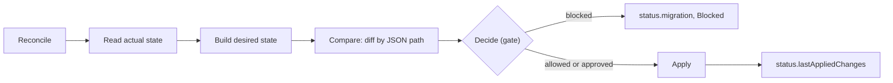

<!--
SPDX-FileCopyrightText: 2026 Deutsche Telekom AG

SPDX-License-Identifier: CC0-1.0
-->

# ADR-0012: One change pipeline for the gateway, identity and pubsub operators

- Status: Accepted
- Date: 2026-11-20
- Related: [ADR-0006](0006-migration-mode-diff-guard.md), [ADR-0009](0009-plan-kong-changes-as-one-bundle.md), [ADR-0010](0010-approval-by-diff-hash.md), [ADR-0013](0013-record-last-applied-changes.md), [ADR-0014](0014-mask-secrets-in-change-records.md)

## Context

Migration Mode ([ADR-0006](0006-migration-mode-diff-guard.md) to [ADR-0011](0011-pending-changes-in-status.md)) was built for the gateway operator and Kong only. The identity operator (Keycloak) and the pubsub operator (Horizon) also take over configuration from the legacy Java operator, so they need the same protection: no unexpected change reaches the backend unnoticed.

The gateway code is about 1,100 lines in `gateway/pkg/kong/migration`. Most of it, the diff, path matching, plan, hash and decision, does not depend on Kong. If each operator built its own version, the three would drift apart in behaviour, configuration, status format and approval.

Today the operators write to their backends differently:

| Operator | Backend | Reads before writing | Writes |
| -------- | ------- | -------------------- | ------ |
| gateway | Kong | Yes, through one central function `reconcile()` | Through `reconcile()` |
| identity | Keycloak | For clients (`getClient`, `CompareClientRepresentation`), partly for realms | Many direct API calls: realm, client, scopes, mappers, policies, secret rotation |
| pubsub | Horizon | No. `ConfigService` has only `PutSubscription` and `DeleteSubscription` | Two direct calls |

Horizon will offer a GET endpoint for subscriptions. This ADR assumes it.

## Decision

All three operators use one change pipeline from `common/pkg/changeset`:

**Shared in `common/pkg/changeset`:**

| Piece | Content |
| ----- | ------- |
| Diff | Canonical JSON, diff by JSON path, ignore matching with `.*` and `[*]` |
| Plan | Recorded changes in write order, placeholder IDs for planned creates, hash |
| Gate | Modes `off`, `on`, `strict`, ignore rules, approval by hash, decision per bundle |
| Write driver | `Reconcile[Req, Resp]` and `Delete` on one entity interface: `Kind`, `Name`, `Get`, `Project`, `Write`, optional `Comparable` |
| Handler flow | `Run(ctx, gate, obj, kind, build)`: plan, decide, set the status, then block or apply |
| Status types | `MigrationStatus` (pending) and `AppliedChanges` (last applied, see [ADR-0013](0013-record-last-applied-changes.md)) in `common/pkg/types` |
| Approval | Annotation `cp.ei.telekom.de/migration-approved-hash` and a predicate that starts a reconcile when it changes |
| Configuration | Flags `--migration-mode` and `--migration-ignore-config`, the ignore-list loader, kind registration |
| Metrics | `controlplane_migration_checks_total{operator, kind, outcome}` and `controlplane_migration_diffs_total{operator, entity, outcome}` |

**Per operator:**

| | gateway | identity | pubsub |
| - | ------- | -------- | ------ |
| Entities | route, service, upstream, target, plugin, consumer, consumer_group | realm, client, client_scope, protocol_mapper, client_policy, client_profile, client_secret_rotation | subscription |
| Read | Existing discovery | Existing reads, plus reads for scopes, mappers and policies | New `GetSubscription` |
| Normalization | Existing: sorted sets, legacy tags, narrowed plugin config | Keycloak defaults, attribute order, secrets masked ([ADR-0014](0014-mask-secrets-in-change-records.md)) | Server-generated fields left out |
| Bundle | Route, Consumer | Realm, Client | Subscriber |

Rules for every operator:

- Every write and delete to the backend goes through the shared write driver. A direct API call that bypasses it is a bug.
- Every entity kind is registered at startup. An ignore rule for an unknown kind stops the operator.
- Collections from Kubernetes lists are sorted before the build, so the plan and its hash are reproducible.
- Each operator has its own `--migration-mode` and ignore list, so they can be switched over one by one.
- A reconcile without any change keeps the result of the plan and does not run the apply pass, so it reads the backend once. A reconcile with changes reads it twice: the apply pass reads again, because its writes change what later reads must see.

The gateway package `gateway/pkg/kong/migration` moves to `common/pkg/changeset`. The gateway operator switches first, then pubsub, then identity. For the gateway operator, the switch renames the approval annotation and the metrics as above and adds the records of [ADR-0013](0013-record-last-applied-changes.md) and the masking of [ADR-0014](0014-mask-secrets-in-change-records.md); Migration Mode has not been deployed, so no compatibility is kept.

## Consequences

- One behaviour, one configuration format, one status format and one approval flow for all three backends. Reviewers learn it once.
- All operators are built and released together in one release, so a change of the shared package needs no coordinated version bumps.
- The identity operator needs the most work: its direct Keycloak calls must move behind entity adapters. Secret rotation becomes a planned change of its own.
- The pubsub operator depends on the new Horizon GET endpoint.
- Every reconcile runs the plan pass. A reconcile without changes, the usual case, reads the backend once as today; only a reconcile with changes reads it twice. This extra load is accepted, because all three operators need the logic.
- The `status` of Route, Consumer, Realm, Client and Subscriber gets the fields `migration` and `lastAppliedChanges`. The CRDs are regenerated in each module.

## Alternatives considered

- **A copy per operator.** Rejected: three versions would drift apart, and reviewers would need to learn three flows.
- **A separate migration service that compares snapshots of all backends.** Rejected: it would find differences only after they were written and could not block them.
- **Share only the diff, keep gate and status per operator.** Rejected: the gate, status and approval are what reviewers use, so they must be the same everywhere.
- **Reuse the reads of the plan pass in the apply pass.** Rejected: after the first write, later reads must see it, so a cache would need exact invalidation per backend. Skipping the apply pass when nothing changes gives most of the saving without that risk.
