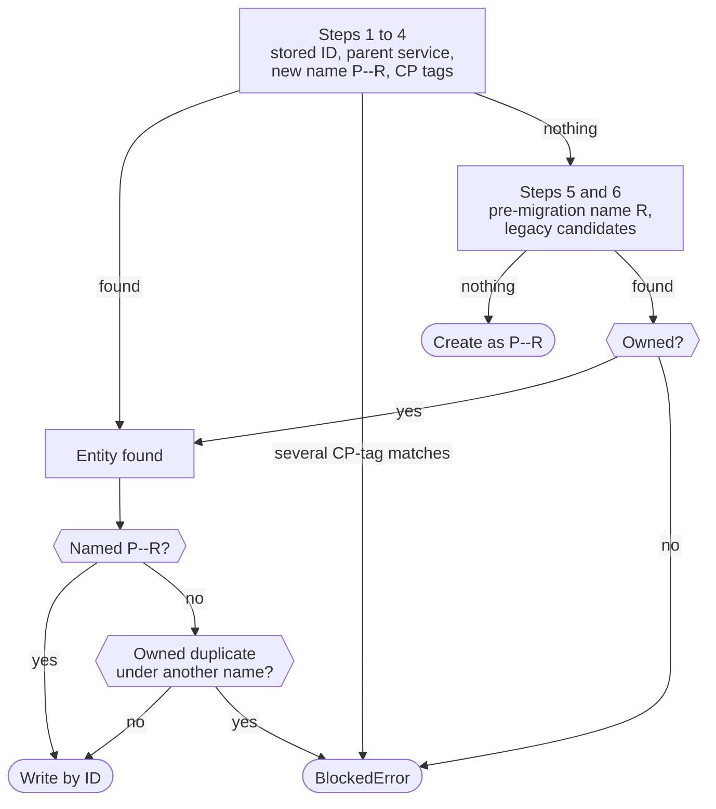
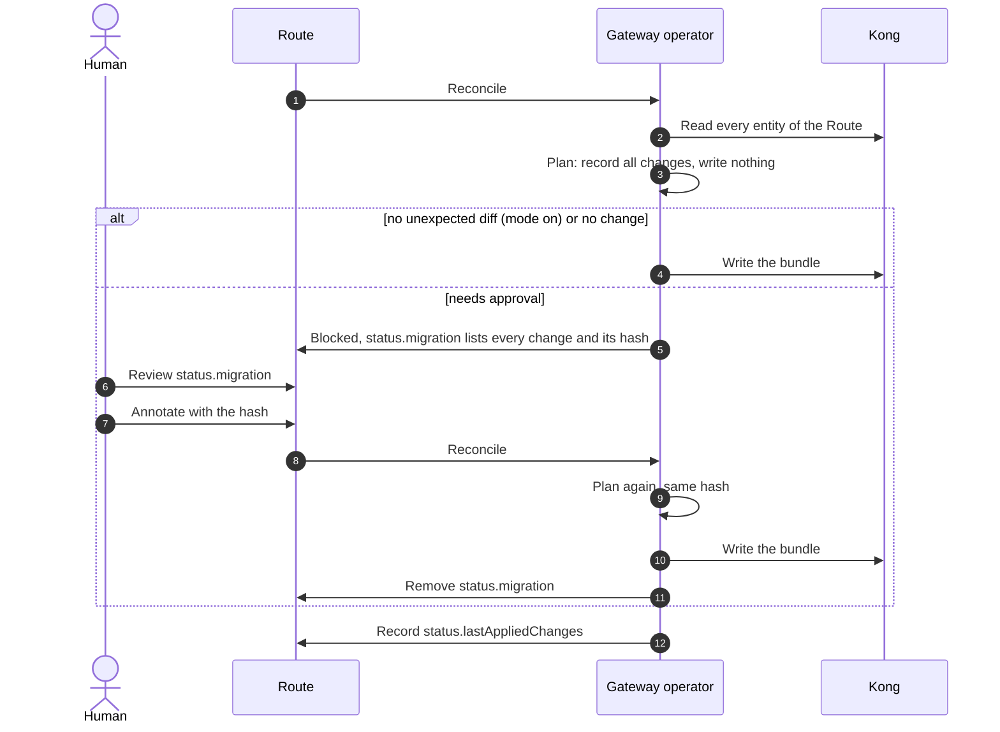

# Gateway: Migrating Kong Entities

<!--
SPDX-FileCopyrightText: 2026 Deutsche Telekom AG

SPDX-License-Identifier: CC0-1.0
-->

When a Route's Gateway gets a `spec.namePrefix`, the Route's Kong entities move to the name `<namePrefix>--<metadata.name>` (see [Kong entity naming and realms](./gateway.mdx#kong-entity-naming-and-realms)). Kong may already hold these entities under an older name. The Gateway operator finds them, checks that they belong to the Route and renames them in place, so their Kong IDs stay the same.

Older names come from two sources:

| Source | Example name | Recognised by |
| ------ | ------------ | ------------- |
| The Gateway operator before realm naming | `eni-echo-v3` (`metadata.name`) | the tags `env--<env>` and `route--<metadata.name>` |
| The legacy operator | `bond.eni-echo-v3` | the tag `ei__telekom__de--realm---<legacyRealm>` |

Everything on this page applies only to Routes on a Gateway with a `namePrefix`; all of them are migrated, including identity, zone-health and Admin managed routes. Routes on a Gateway without a prefix are looked up by `metadata.name`, exactly as before. Plugins are the exception: their legacy adoption works for every Route and is described in [Kong plugin ownership](./gateway.mdx#lookup-order).

In the examples, `P` is the `namePrefix` of the Route's Gateway, `R` its `metadata.name` and `E` the environment.

## Discovery chain

Route, service and upstream are each looked up by a chain of steps; the first step that finds an entity wins. Steps 1 to 4 find entities that are ours by construction; the new-name step only rejects an entity tagged for another environment or Route. Steps 5 and 6 check ownership first. The [steps per entity kind](#steps-per-entity-kind) are listed below.



The diagram shows a reconcile. A delete runs the same chain but never blocks; see [Conflicts](#conflicts).

### Steps per entity kind

| Step | Route | Service | Upstream (circuit breaker) |
| ---- | ----- | ------- | -------------------------- |
| 1. Stored ID | `routeId` | `serviceId` | `upstreamId` |
| 2. Parent | – | the service of the found route | – |
| 3. New name `P--R` | yes | yes | yes |
| 4. CP tags `env--E`, `route--R` | yes | yes | yes |
| 5. Pre-migration name `R` | yes | yes | yes, CP tags only |
| 6. Legacy candidates | yes | yes | no: legacy routes have no upstream |

The stored IDs are read from `status.properties` at the start of each reconcile, before the properties are rebuilt (see [Status properties](./gateway.mdx#status-properties)).

### Ownership

| Step | What proves the entity belongs to the Route |
| ---- | ------------------------------------------- |
| Stored ID, parent | Nothing extra: the entity is ours by construction. |
| New name `P--R` | No `env--` or `route--` tag of another environment or Route. An unprefixed Route `bond--orders` therefore keeps its entities from a Route `orders` with prefix `bond`. |
| CP tags | The tags that were searched for. |
| Pre-migration name `R` | `env--E` and `route--R`, or the owner tag of a legacy candidate that has the same name `R`. |
| Legacy candidate | The candidate's owner tag `ei__telekom__de--realm---<legacyRealm>`, or `env--E` and `route--R`. |

Examples for a Route `eni-foo-v1`:

| Kong route | Tags | Gateway's `namePrefix` | Found at | Result |
| ---------- | ---- | -------------------- | -------- | ------ |
| `eni-foo-v1` | `env--bond`, `route--eni-foo-v1` | `bond` | 5. Pre-migration name | Owned, renamed to `bond--eni-foo-v1` |
| `eni-foo-v1` | `ei__telekom__de--realm---default` | `default` | 5. Pre-migration name (also the legacy `default` name) | Owned, renamed to `default--eni-foo-v1` |
| `eni-foo-v1` | `ei__telekom__de--realm---default` | `bond` | 5. Pre-migration name | Not owned: `BlockedError` |
| `bond.eni-foo-v1` | `ei__telekom__de--realm---bond` | `bond` | 6. Legacy candidate | Owned, renamed to `bond--eni-foo-v1` |
| `default-ai.eni-foo-v1` | `ei__telekom__de--realm---default-ai` | `default` | 6. Legacy candidate | Owned, renamed to `default--eni-foo-v1` |

## Writing a found entity

- **Renamed by ID.** A found entity is written with a full-body `PUT /{entity}/{id}`: new name, merged tags and every other field in one write. A new entity is created with `PUT /{entity}/P--R`. Nothing is written if Kong already matches.
- **Legacy tags are kept.** Tags starting with `ei__telekom__de--` on a found route, service or upstream are merged into the desired tags. They are never removed. All other tags stay fully managed, so removing an `additionalTags` entry still takes effect.
- **Legacy name recorded.** If the route was found under `R` or a legacy name, that name is stored as `legacyName` in the Route status and kept afterwards.
- **Targets follow the upstream ID.** The circuit-breaker target is written to the upstream by its ID, so it works while the upstream is being renamed.
- **Nothing is written before every lookup has succeeded.** Route, service and circuit-breaker upstream are looked up, including the duplicate and sharing checks, before the first write. A blocked migration leaves Kong unchanged, so the service never points to an upstream that was renamed away.
- **Service sharing is checked before a rename and a delete.** A service is renamed only if no other Kong route uses it, however it was found; otherwise the reconcile is blocked. A delete always checks and skips a service another route uses, because Kong refuses to delete it. Once the service is named `P--R`, a reconcile no longer checks.
- **A stored ID claimed by another route is ignored.** Before the migration, environments with the same Route name shared one unprefixed entity and recorded the same ID. An entity found by stored ID or through its parent whose `env--` or `route--` tag names another environment or route is skipped, and discovery goes on with the next step. Entities without these tags, such as legacy ones, are still found.
- **Circuit-breaker removal.** When the circuit breaker is disabled or removed, or the Route leaves primary, the service is updated before the upstream is deleted. The upstream selected by the other features is kept, including Jumper's `/listener` endpoint when RouteListeners are attached. For a Route with a prefix the upstream is found by discovery even without a stored `upstreamId`; a foreign upstream is never deleted. Kong deletes the upstream's targets with it.

:::note Known risk
The circuit-breaker upstream is written before the service. Within one reconcile, the service host can point to the old upstream name for a few seconds after the upstream was renamed.
:::

## Legacy-compatible naming

The legacy operator named a route and its service the same:

| Legacy realm | Kong name | Example |
| ---------- | --------- | ------- |
| `default` | `<baseName>` | `eni-gateway-aws-echo-v1` |
| any other realm | `<legacyRealm>.<baseName>` | `bond.eni-echo-v3` |
| AI realm (`<realm>-ai`) | `<realm>-ai.<baseName>` | `default-ai.ai-gateway--dhrani-bo-radio-mcp-v1` |

Legacy routes, services and plugins carry the tag `ei__telekom__de--realm---<legacyRealm>`. Plugins are bound to the route by ID.

`baseName` equals `metadata.name`. The Event domain names its Routes after the legacy-compatible base names:

| Former CP `metadata.name` | CP `metadata.name` = legacy-compatible `baseName` |
| ------------------ | --------------- |
| `publish` | `horizon-events` |
| `callback--<zone>` | `horizon-callback-<zone>` |
| `voyager--<zone>` | `horizon-voyager-<zone>` |
| `sse--<eventTypeName>` | `horizon-sse--<eventTypeName>` |

The CP `horizon-events` Route also has the path `/horizon/publish/v1`, which no legacy route has. The normal reconcile adds it after adoption.

The `Migrator` turns these names into an ordered list of candidate names, one per legacy realm `P + suffix`. Candidates equal to `P--R` or `R` are dropped; a candidate named `R` adds its owner tag to the pre-migration step instead. With the [sample configuration](#legacy-naming-configuration):

| Route | `namePrefix` | Candidates, in order |
| ----- | ------------ | -------------------- |
| `eni-echo-v3` | `bond` | `bond.eni-echo-v3`, `bond-ai.eni-echo-v3` |
| `eni-foo-v1` | `default` | `default-ai.eni-foo-v1` (the `default` name `eni-foo-v1` is checked as the pre-migration name) |
| `horizon-events` | `bond` | `bond.horizon-events`, `bond-ai.horizon-events` |

## Conflicts

A conflict is an entity the Route may not use: it fails the ownership check, several entities match the CP tags, or a second owned entity exists under another known name (`P--R`, `R` or a legacy candidate). The duplicate check runs only while the found entity still needs a rename, so a migrated Route costs no extra lookups.

| Situation | Reconcile | Delete |
| --------- | --------- | ------ |
| Entity under a name is not owned | `BlockedError` | Skipped and logged; the lookup continues with the next step. |
| More than one CP-tag match | `BlockedError` | Skipped and logged; the lookup continues. |
| Owned duplicate under another name | `BlockedError` | The entity from the earliest step is deleted; the duplicate is logged and left in place. |
| Rename pending, but `P--R` is held by an entity that is not ours | `BlockedError` naming the occupant's `env--`/`route--` tags; nothing is written. | The occupant is skipped and logged; our entity is deleted. |
| Service found through its route or a legacy name is used by another route | `BlockedError` | Skipped and logged. |
| Nothing found | Created as `P--R` | Succeeds without deleting anything. |

A delete removes at most one route, one service and one upstream, each by ID. It never gets stuck, so a Route whose reconcile is blocked can still be removed. Nothing is ever deleted automatically during a reconcile: duplicates have to be resolved by hand.

If a delete fails after it removed the first entity, for example while deleting the service, the retry can find the retained duplicate and delete it as well. Duplicates exist only if the legacy operator wrote after the takeover, which the migration rules out.

## Legacy naming configuration

The legacy naming configuration lives in an optional file, passed with the operator flag `--legacy-naming-config=<path>` and mounted from a ConfigMap.

| Situation | Behaviour |
| --------- | --------- |
| Flag not set | No legacy candidates. Steps 1–5 still run. |
| File valid | Legacy candidates are tried in step 6. |
| File missing, invalid YAML or unknown field | The operator fails at startup. |

Sample ConfigMap, shipped as `gateway/config/samples/legacy_naming_configmap.yaml`:

```yaml
# Mounted into the operator and passed as --legacy-naming-config=/etc/gateway/legacy-naming.yaml
apiVersion: v1
kind: ConfigMap
metadata:
  name: gateway-legacy-naming
data:
  legacy-naming.yaml: |
    # Legacy naming, used only to find legacy Kong entities.
    defaultRealm: default        # Legacy realm whose names carry no realm prefix
    separator: "."               # legacyName = <legacyRealm><separator><baseName>
    realmSuffixes: ["", "-ai"]   # Legacy realms tried for a Route with namePrefix P: P + suffix
```

| Field | Meaning |
| ----- | ------- |
| `defaultRealm` | Legacy realm whose names have no realm prefix. |
| `separator` | Joins the legacy realm and the base name. |
| `realmSuffixes` | Appended to `namePrefix` to build the legacy realms to try, in order. |

## Migration Mode

Migration Mode makes the switch from the legacy operator safe. The Gateway operator compares the Kong changes of a Route or Consumer with the current Kong state before it writes any of them. A difference that is not expected blocks all of them and is shown on the Route or Consumer. Kong stays as the legacy operator left it until the difference is expected, fixed or approved.

The comparison is the shared change pipeline in `common/pkg/changeset` ([ADR-0012](https://github.com/telekom/controlplane/blob/main/docs/adrs/0012-shared-changeset-for-all-backend-operators.md)). It always runs; Migration Mode only decides whether a change needs an approval. Every applied change is recorded on the Route or Consumer, also with Migration Mode `off`.

| Mode | The Kong changes of a Route or Consumer are written if |
| ---- | ------------------------------------------------------ |
| `off` | always. This is the default. |
| `on` | every diff is on the ignore list, or the changes are approved. |
| `strict` | the changes are approved, even if every diff is on the ignore list. |

A reconcile without any Kong change writes nothing, so it needs no approval in either mode, and it reads Kong only once.

### One plan for the whole Route

Each reconcile first runs the plan: it goes through every Kong entity of the Route or Consumer and records each create, update and delete instead of executing it. Together, these changes are the bundle. The operator then decides on the bundle as a whole. A bundle without changes is done after the plan. Only an allowed or approved bundle is written, in a second run.

| Object | Bundle |
| ------ | ------ |
| Route | Upstream and targets of the circuit breaker, service, route, its plugins and the removal of plugins it no longer uses |
| Consumer | Consumer, consumer group membership and its plugins |
| Deleted Route or Consumer | The deletion of its Kong entities |

An entity the plan would create does not exist yet. The plan gives it a placeholder ID starting with `planned--`, so that the entities that depend on it, such as the route of a new service, can be planned too.



### What is compared

| Change | Compared as |
| ------ | ----------- |
| Update of a route, service, upstream, target, plugin or consumer | Every field, by JSON path, such as `$.tags` or `$.config.minute` |
| Creation of an entity or of a consumer group membership | One diff at `$` with the whole new entity |
| Deletion of a route, service, upstream, plugin or consumer | One diff at `$` |

Both sides are compared as the operator compares them for a normal reconcile. Tags, hosts and protocols are sorted. Legacy tags of an adopted entity are kept. Plugin config fields the operator does not set are left out. A missing value, `null`, an empty list and an empty object count as the same. Lists of different length differ as a whole; lists of equal length differ per element.

Secrets never appear in clear ([ADR-0014](https://github.com/telekom/controlplane/blob/main/docs/adrs/0014-mask-secrets-in-change-records.md)). The Redis password of rate limiting and the values of the `jumper_config` and `routing_config` request headers, which carry client secrets and basic-auth passwords, are replaced on both sides with `sha256:` and the first 16 hex digits of their hash. A failover route passes its jumper config inside `routing_config`. A changed secret is still a diff, but its value is not shown.

### Reviewing blocked changes

A blocked Route or Consumer has the condition `Blocked`, a Warning event and the field `status.migration`. The field exists only while the changes are blocked:

```bash
kubectl get route eni-echo-v1 -o jsonpath='{.status.migration}' | jq
```

```yaml
status:
  migration:
    hash: 7fb798163a653a9e
    mode: on
    changes:
      - kind: service
        name: bond--eni-echo-v1
        operation: update
        diffs:
          - path: $.name
            desired: '"bond--eni-echo-v1"'
            current: '"bond.eni-echo-v1"'
            ignored: true
      - kind: route
        name: bond--eni-echo-v1
        operation: update
        diffs:
          - path: $.paths[0]
            desired: '"/eni/echo/v3"'
            current: '"/eni/echo/v2"'
```

Values are JSON. A value longer than 1024 characters is cut off, and at most 100 diffs are shown; `truncated: true` marks a cut status. The hash covers all changes and full values. The operator log has the full changes under `Migration mode blocked backend changes`.

Two metrics count the checks, with the label `operator="gateway"`:

- `controlplane_migration_checks_total` counts reconciles per kind (`Route`, `Consumer`), with the outcome `unchanged`, `allowed`, `approved` or `blocked`.
- `controlplane_migration_diffs_total` counts diffs per entity kind, with the outcome `ignored` or `unexpected`.

### Approving blocked changes

Approve the reviewed changes with their hash:

```bash
kubectl annotate route eni-echo-v1 \
  cp.ei.telekom.de/migration-approved-hash=7fb798163a653a9e --overwrite
```

The annotation starts a new reconcile. It plans again and writes the bundle only if the new plan has the same hash. The hash covers every change and every value, so an approval covers exactly what was reviewed. If the Route changes or the legacy operator changes Kong in between, the hash changes, and the new changes are blocked and shown again. Approved changes are logged under `Migration mode applies approved backend changes`.

An approval stays valid as long as the hash does not change. It does not have to be removed. Who set the annotation is recorded in the Kubernetes API audit log.

### Last applied changes

Every bundle that is written is recorded in `status.lastAppliedChanges` ([ADR-0013](https://github.com/telekom/controlplane/blob/main/docs/adrs/0013-record-last-applied-changes.md)), in every mode. The record is replaced by the next written bundle; a reconcile without changes keeps it. It is not a history: each written bundle also emits the event `ChangesApplied` with its hash, and the operator logs it.

```yaml
status:
  lastAppliedChanges:
    hash: 7fb798163a653a9e
    appliedAt: "2026-11-20T15:20:00Z"
    generation: 7
    mode: on
    decision: approved
    approvedHash: 7fb798163a653a9e
    changes:
      - kind: route
        name: bond--eni-echo-v1
        operation: update
        diffs:
          - path: $.paths[0]
            desired: '"/eni/echo/v3"'
            current: '"/eni/echo/v2"'
```

| Field | Meaning |
| ----- | ------- |
| `decision` | `allowed` if no approval was needed, `approved` if the hash was approved |
| `mode` | Migration Mode when the bundle was written |
| `generation` | `metadata.generation` the bundle was built from |
| `changes` | As in `status.migration`, but a created entity is recorded by the hash of its body |

### Configuration

| Flag | Meaning |
| ---- | ------- |
| `--migration-mode=<off\|on\|strict>` | Sets the mode. `off` by default. |
| `--migration-ignore-config=<path>` | Optional ignore list of expected diffs, mounted from a ConfigMap. Without it, every diff needs an approval in mode `on`. |

An unknown mode, a missing file, invalid YAML, an unknown field, an unknown kind or an invalid path stops the operator at startup.

Sample ConfigMap, shipped as `gateway/config/samples/migration_ignore_configmap.yaml`:

```yaml
# Mounted into the operator and passed as
# --migration-mode=on --migration-ignore-config=/etc/gateway/migration-ignore.yaml
apiVersion: v1
kind: ConfigMap
metadata:
  name: gateway-migration-ignore
data:
  migration-ignore.yaml: |
    ignore:
      # Routes and services are renamed to <namePrefix>--<name> and get new ownership tags.
      - kind: route
        paths: ["$.name", "$.tags"]
      - kind: service
        paths: ["$.name", "$.tags"]
      # The operator may create and update its own rate-limiting plugins.
      - kind: plugin
        name: rate-limiting-merged
        paths: ["$"]
```

| Field | Meaning |
| ----- | ------- |
| `kind` | `route`, `service`, `upstream`, `target`, `plugin`, `consumer` or `consumer_group`. |
| `name` | Optional regular expression. It must match the whole entity name. |
| `paths` | JSON paths of the expected diffs. A path also covers everything below it. |

The entity name is the Kong name for routes, services and upstreams. For plugins it is the plugin name, for targets the target and for consumers the username. A deletion of a route or service uses its Kong name. A deletion of an upstream uses the name or ID it is deleted by.

A path starts with `$`, followed by `.key` and `[index]` parts. `.*` matches any key and `[*]` any index. `$` alone covers the whole entity, including its creation and deletion.

## Scope and limitations

- **Who sets the prefix.** The Admin operator sets `Gateway.spec.namePrefix` to the environment's realm name, except for the realm `default` while `FEATURE_LEGACY_GATEWAY_NAMING_ENABLED` is `true`. The Event operator names its Routes after the legacy-compatible base names. The API and Agentic operators are unchanged.
- **Out of scope.** Kong consumer name collisions across virtual environments, and removing legacy `ei__telekom__de--*` tags.
- **Changing the prefix works, removing it does not.** A changed `namePrefix` is followed through the stored ID or the CP tags; the Route controller reconciles all Routes of the Gateway when it changes. Without a prefix, the operator looks up only `metadata.name` and never sees the entity named `P--R`, so the Gateway CRD rejects removing or emptying a set prefix.

:::warning Ownership handoff
Stop the legacy operator for a route before the Gateway operator takes it over; it must not write the route afterwards. Once a route is named `<namePrefix>--<metadata.name>`, the conflict check is skipped, so a route that the legacy operator recreates under its old name is not detected and Kong would hold two routes for the same path.
:::

## Related Pages

- [Architecture: Gateway Domain](./gateway.mdx)
