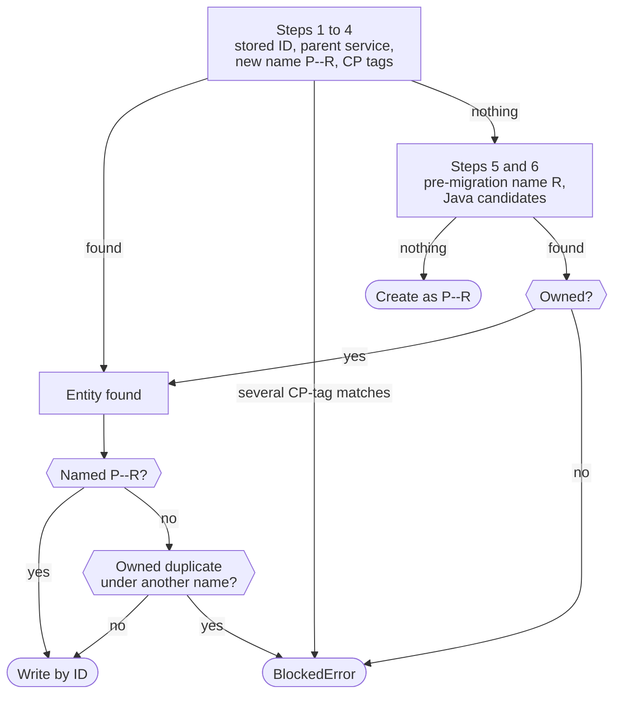

# Gateway: Migrating Kong Entities

<!--
SPDX-FileCopyrightText: 2026 Deutsche Telekom AG

SPDX-License-Identifier: CC0-1.0
-->

When a Route's Gateway gets a `spec.namePrefix`, the Route's Kong entities move to the name `<namePrefix>--<metadata.name>` (see [Kong entity naming and realms](./gateway.mdx#kong-entity-naming-and-realms)). Kong may already hold these entities under an older name. The Gateway operator finds them, checks that they belong to the Route and renames them in place, so their Kong IDs stay the same.

Older names come from two sources:

| Source | Example name | Recognised by |
| ------ | ------------ | ------------- |
| The Gateway operator before realm naming | `eni-echo-v3` (`metadata.name`) | the tags `env--<env>` and `route--<metadata.name>` |
| The legacy Java operator | `bond.eni-echo-v3` | the tag `ei__telekom__de--realm---<javaRealm>` |

Everything on this page applies only to Routes on a Gateway with a `namePrefix`; all of them are migrated, including identity, zone-health and Admin managed routes. Routes on a Gateway without a prefix are looked up by `metadata.name`, exactly as before. Plugins are the exception: their legacy adoption works for every Route and is described in [Kong plugin ownership](./gateway.mdx#lookup-order).

In the examples, `P` is the `namePrefix` of the Route's Gateway, `R` its `metadata.name` and `E` the environment.

## Discovery chain

Route, service and upstream are each looked up by a chain of steps; the first step that finds an entity wins. Steps 1 to 4 find entities that are ours by construction; the new-name step only rejects an entity tagged for another environment or Route. Steps 5 and 6 check ownership first. The [steps per entity kind](#steps-per-entity-kind) are listed below.



The diagram shows a reconcile. A delete runs the same chain but never blocks; see [Conflicts](#conflicts).

### Steps per entity kind

| Step | Route | Service | Upstream (circuit breaker) |
| ---- | ----- | ------- | -------------------------- |
| 1. Stored ID | `routeId` | `serviceId` | `upstreamId` |
| 2. Parent | – | the service of the found route | – |
| 3. New name `P--R` | yes | yes | yes |
| 4. CP tags `env--E`, `route--R` | yes | yes | yes |
| 5. Pre-migration name `R` | yes | yes | yes, CP tags only |
| 6. Java candidates | yes | yes | no: Java routes have no upstream |

The stored IDs are read from `status.properties` at the start of each reconcile, before the properties are rebuilt (see [Status properties](./gateway.mdx#status-properties)).

### Ownership

| Step | What proves the entity belongs to the Route |
| ---- | ------------------------------------------- |
| Stored ID, parent | Nothing extra: the entity is ours by construction. |
| New name `P--R` | No `env--` or `route--` tag of another environment or Route. An unprefixed Route `bond--orders` therefore keeps its entities from a Route `orders` with prefix `bond`. |
| CP tags | The tags that were searched for. |
| Pre-migration name `R` | `env--E` and `route--R`, or the owner tag of a Java candidate that has the same name `R`. |
| Java candidate | The candidate's owner tag `ei__telekom__de--realm---<javaRealm>`, or `env--E` and `route--R`. |

Examples for a Route `eni-foo-v1`:

| Kong route | Tags | Gateway's `namePrefix` | Found at | Result |
| ---------- | ---- | -------------------- | -------- | ------ |
| `eni-foo-v1` | `env--bond`, `route--eni-foo-v1` | `bond` | 5. Pre-migration name | Owned, renamed to `bond--eni-foo-v1` |
| `eni-foo-v1` | `ei__telekom__de--realm---default` | `default` | 5. Pre-migration name (also the Java `default` name) | Owned, renamed to `default--eni-foo-v1` |
| `eni-foo-v1` | `ei__telekom__de--realm---default` | `bond` | 5. Pre-migration name | Not owned: `BlockedError` |
| `bond.eni-foo-v1` | `ei__telekom__de--realm---bond` | `bond` | 6. Java candidate | Owned, renamed to `bond--eni-foo-v1` |
| `default-ai.eni-foo-v1` | `ei__telekom__de--realm---default-ai` | `default` | 6. Java candidate | Owned, renamed to `default--eni-foo-v1` |

## Writing a found entity

- **Renamed by ID.** A found entity is written with a full-body `PUT /{entity}/{id}`: new name, merged tags and every other field in one write. A new entity is created with `PUT /{entity}/P--R`. Nothing is written if Kong already matches.
- **Legacy tags are kept.** Tags starting with `ei__telekom__de--` on a found route, service or upstream are merged into the desired tags. They are never removed. All other tags stay fully managed, so removing an `additionalTags` entry still takes effect.
- **Legacy name recorded.** If the route was found under `R` or a Java name, that name is stored as `legacyName` in the Route status and kept afterwards.
- **Targets follow the upstream ID.** The circuit-breaker target is written to the upstream by its ID, so it works while the upstream is being renamed.
- **Nothing is written before every lookup has succeeded.** Route, service and circuit-breaker upstream are looked up, including the duplicate and sharing checks, before the first write. A blocked migration leaves Kong unchanged, so the service never points to an upstream that was renamed away.
- **Service sharing is checked before a rename.** A service found through its route or under a legacy name is renamed only if no other Kong route uses it; otherwise the reconcile is blocked and a delete skips the service. Once the service is named `P--R`, this check no longer runs.
- **Circuit-breaker removal.** When the circuit breaker is disabled or removed, the service is pointed back to the proxy before the upstream is deleted. For a Route with a prefix the upstream is found by discovery even without a stored `upstreamId`; a foreign upstream is never deleted.

:::note Known risk
The circuit-breaker upstream is written before the service. Within one reconcile, the service host can point to the old upstream name for a few seconds after the upstream was renamed.
:::

## Java naming

The legacy Java operator named a route and its service the same:

| Java realm | Kong name | Example |
| ---------- | --------- | ------- |
| `default` | `<baseName>` | `eni-gateway-aws-echo-v1` |
| any other realm | `<javaRealm>.<baseName>` | `bond.eni-echo-v3` |
| AI realm (`<realm>-ai`) | `<realm>-ai.<baseName>` | `default-ai.ai-gateway--dhrani-bo-radio-mcp-v1` |

Java routes, services and plugins carry the tag `ei__telekom__de--realm---<javaRealm>`. Plugins are bound to the route by ID.

For API and AI Routes, `baseName` equals `metadata.name`. Event Routes use other base names:

| CP `metadata.name` | Java `baseName` |
| ------------------ | --------------- |
| `publish` | `horizon-events` |
| `callback--<zone>` | `horizon-callback-<zone>` |
| `voyager--<zone>` | `horizon-voyager-<zone>` |
| `sse--<eventTypeName>` | `horizon-sse--<eventTypeName>` |

The CP `publish` Route also has the path `/horizon/publish/v1`, which no Java route has. The normal reconcile adds it after adoption.

The `Migrator` turns these rules into an ordered list of candidate names, one per Java realm `P + suffix`. Candidates equal to `P--R` or `R` are dropped; a candidate named `R` adds its owner tag to the pre-migration step instead. With the [sample configuration](#legacy-naming-configuration):

| Route | `namePrefix` | Candidates, in order |
| ----- | ------------ | -------------------- |
| `eni-echo-v3` | `bond` | `bond.eni-echo-v3`, `bond-ai.eni-echo-v3` |
| `eni-foo-v1` | `default` | `default-ai.eni-foo-v1` (the `default` name `eni-foo-v1` is checked as the pre-migration name) |
| `publish`, label `cp.ei.telekom.de/domain: event` | `bond` | `bond.horizon-events`, `bond-ai.horizon-events` |

## Conflicts

A conflict is an entity the Route may not use: it fails the ownership check, several entities match the CP tags, or a second owned entity exists under another known name (`P--R`, `R` or a Java candidate). The duplicate check runs only while the found entity still needs a rename, so a migrated Route costs no extra lookups.

| Situation | Reconcile | Delete |
| --------- | --------- | ------ |
| Entity under a name is not owned | `BlockedError` | Skipped and logged; the lookup continues with the next step. |
| More than one CP-tag match | `BlockedError` | Skipped and logged; the lookup continues. |
| Owned duplicate under another name | `BlockedError` | The entity from the earliest step is deleted; the duplicate is logged and left in place. |
| Rename pending, but `P--R` is held by an entity that is not ours | `BlockedError` naming the occupant's `env--`/`route--` tags; nothing is written. | The occupant is skipped and logged; our entity is deleted. |
| Service found through its route or a legacy name is used by another route | `BlockedError` | Skipped and logged. |
| Nothing found | Created as `P--R` | Succeeds without deleting anything. |

A delete removes at most one route, one service and one upstream, each by ID. It never gets stuck, so a Route whose reconcile is blocked can still be removed. Nothing is ever deleted automatically during a reconcile: duplicates have to be resolved by hand.

If a delete fails after it removed the first entity, for example while deleting the service, the retry can find the retained duplicate and delete it as well. Duplicates exist only if the Java operator wrote after the takeover, which the migration rules out.

## Legacy naming configuration

The Java naming rules live in an optional file, passed with the operator flag `--legacy-naming-config=<path>` and mounted from a ConfigMap.

| Situation | Behaviour |
| --------- | --------- |
| Flag not set | No Java candidates. Steps 1–5 still run. |
| File valid | Java candidates are tried in step 6. |
| File missing, unknown field, empty or invalid regular expression | The operator fails at startup. |

Sample ConfigMap, shipped as `gateway/config/samples/legacy_naming_configmap.yaml`:

```yaml
# Mounted into the operator and passed as --legacy-naming-config=/etc/gateway/legacy-naming.yaml
apiVersion: v1
kind: ConfigMap
metadata:
  name: gateway-legacy-naming
data:
  legacy-naming.yaml: |
    # Java operator naming, used only to find legacy Kong entities.
    defaultRealm: default        # Java realm whose names carry no realm prefix
    separator: "."               # javaName = <javaRealm><separator><baseName>
    realmSuffixes: ["", "-ai"]   # Java realms tried for a Route with namePrefix P: P + suffix
    names:                       # first matching rule wins; no match → baseName = metadata.name
      - selector: { cp.ei.telekom.de/domain: event }
        match: '^publish$'
        replace: 'horizon-events'
      - selector: { cp.ei.telekom.de/domain: event }
        match: '^callback--(.+)$'
        replace: 'horizon-callback-$1'
      - selector: { cp.ei.telekom.de/domain: event }
        match: '^voyager--(.+)$'
        replace: 'horizon-voyager-$1'
      - selector: { cp.ei.telekom.de/domain: event }
        match: '^sse--(.+)$'
        replace: 'horizon-sse--$1'
```

| Field | Meaning |
| ----- | ------- |
| `defaultRealm` | Java realm whose names have no realm prefix. |
| `separator` | Joins the Java realm and the base name. |
| `realmSuffixes` | Appended to `namePrefix` to build the Java realms to try, in order. |
| `names[].selector` | Labels the Route must all carry for the rule to apply. |
| `names[].match` / `replace` | Regular expression on `metadata.name` and its replacement (`$1` refers to a group). The first matching rule gives the base name. |

**Why the event rules have a selector:** without it, an API Route named `publish` would map to the Java event route `bond.horizon-events`. That route carries the same realm tag, so the ownership check alone would not stop the API Route from taking it over.

## Scope and limitations

- **Who sets the prefix.** The Admin operator sets `Gateway.spec.namePrefix` to the zone's realm name. The API, Agentic and Event operators are unchanged.
- **Out of scope.** Kong consumer name collisions across virtual environments, and removing legacy `ei__telekom__de--*` tags.
- **Changing the prefix works, removing it does not.** A changed `namePrefix` is followed through the stored ID or the CP tags; the Route controller reconciles all Routes of the Gateway when it changes. Without a prefix, the operator looks up only `metadata.name` and never sees the entity named `P--R`, so the Gateway CRD rejects removing or emptying a set prefix.

:::warning Ownership handoff
Stop the legacy Java operator for a route before the Gateway operator takes it over; it must not write the route afterwards. Once a route is named `<namePrefix>--<metadata.name>`, the conflict check is skipped, so a route that the Java operator recreates under its old name is not detected and Kong would hold two routes for the same path.
:::

## Related Pages

- [Architecture: Gateway Domain](./gateway.mdx)
