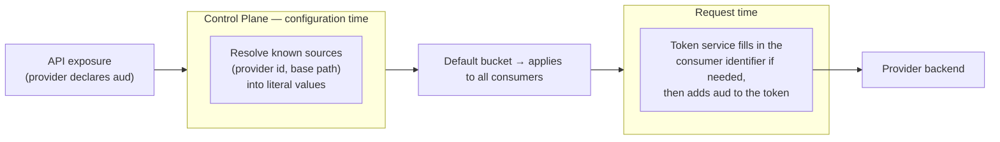
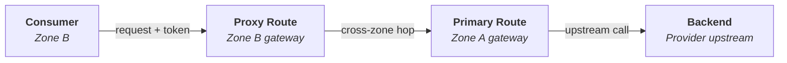
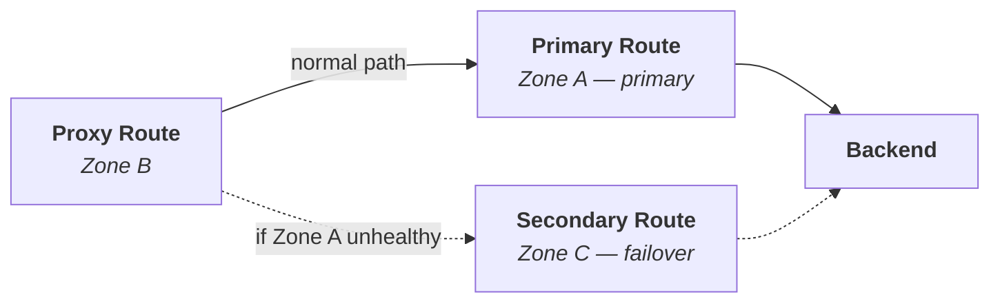
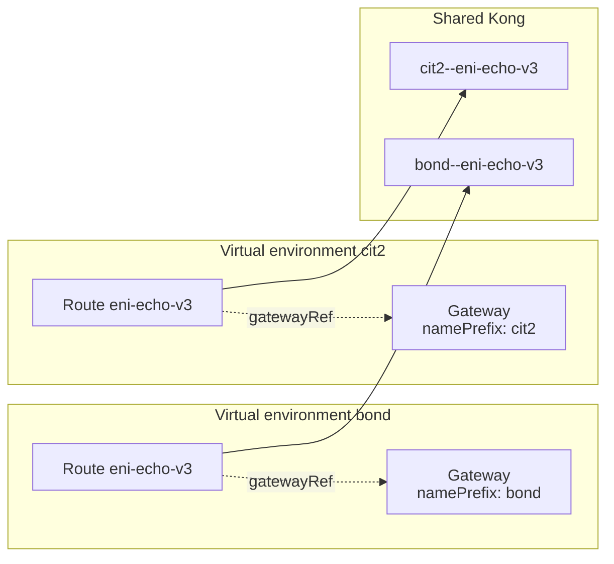
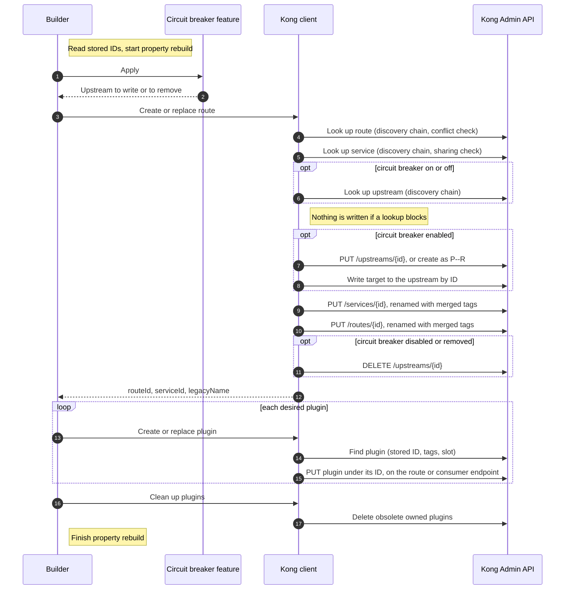
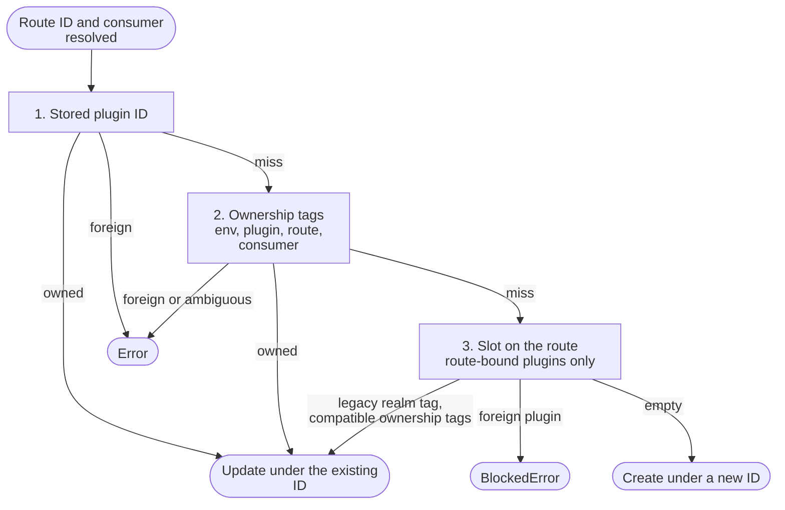

# Gateway Domain

The Gateway domain configures the API Gateway at runtime. It manages routes, consumers, and their access relationships. While the architecture is designed to be gateway-agnostic, the current implementation uses Kong as the underlying gateway technology.

## Custom Resources

<CRDReference domain="gateway" />

## Feature Architecture

The Gateway operator uses a plugin-based feature system for configuring route behavior. Each feature is implemented as a separate plugin that can be enabled or disabled per route, allowing fine-grained control over how requests are processed.

### Host Preservation

A Route's `spec.passThrough` also sets Kong's `preserve_host`. Passthrough routes forward the incoming `Host` header to the upstream. All other routes keep Kong's default, `false`, so the upstream gets its own hostname. There is no separate setting for this. Reconciliation fixes drift in either direction. Upstreams behind passthrough routes, such as managed Proxy routes, must accept the public Host.

### Health Probes

Admin creates a passthrough Route per gateway with `spec.traffic.healthProbe: true` and placeholder upstream `http://localhost:8081/api/v1/zone-health`. The Kong client restricts flagged routes to `HEAD`, and the builder attaches the `request-termination` plugin with status 200. The service is required by Kong, but never called. This checks gateway reachability and route configuration, not backend health.

`healthProbe` is an optional boolean, false when omitted. Unflagged routes keep normal behavior even with the same upstream path. Reconciliation corrects method drift, and disabling the flag clears the restriction and cleans up the plugin. Other HTTP methods do not match the health route, although another overlapping route can match them. No separate methods field is needed. Deploy the updated Route CRD and Gateway controller before Admin.

### Audience Claim Resolution

An API provider can require that every token reaching its backend carries an **audience claim** (`aud`), so the backend can confirm the token was meant for it. The provider declares this once on the API exposure, and the platform makes sure the claim is present on all traffic to that API.

The interesting part is *who* decides the actual value. Some sources are known when the API is configured, while one can only be known at the moment of each request. The Control Plane resolves as much as possible up front and leaves the rest to the request-time token service.

| Source | Known at configuration time? | Resolved by | Result |
| ------ | ---------------------------- | ----------- | ------ |
| Fixed value | Yes | The user | The literal value is used as-is. |
| Provider identifier | Yes — always the exposing application | Control Plane | Filled in as a literal value. |
| Base path | Yes | Control Plane | Filled in as a literal value. |
| Consumer identifier | No — differs for every consumer | Request-time token service | Left as a symbolic reference and filled in per request. |

The consumer identifier cannot be decided in advance: a single exposed API is shared by many consumers, so one fixed value could never represent all of them. Instead, the platform records the source symbolically, and the token service reads the calling consumer's identity from the incoming request and stamps it onto the outgoing token.

The resolved claims are grouped into a **default** bucket that applies to all consumers of the API. The audience claim is declared only on the API exposure by the provider; consumers do not configure it.

:::info
The audience claim is configured by API teams on their Rover file. See [Security: Audience Claims](../user-journey/features/security.mdx#audience-claims) for the user-facing configuration.
:::

## Route Types & Cross-Zone Meshing

Every gateway `Route` has a **type** that determines where it sends traffic. Together, these three types let consumers and providers live in different zones while still reaching each other — a pattern we call *meshing*.

| Type | Lives in | Sends traffic to | Purpose |
|------|----------|------------------|---------|
| **Primary** | The provider's zone | The provider's backend upstreams directly | The single egress point for an API. Every other route ultimately targets it. |
| **Proxy** | A subscriber's zone (when different from the provider's) | The provider zone's gateway (the primary route) | Forwards cross-zone requests. It never talks to the backend itself. |
| **Secondary** | A provider *failover* zone | The provider's backend upstreams (as a backup) | Stand-in for the primary route when the provider's primary zone is unhealthy. |

### Why proxy routes exist

A consumer always sends its request to the gateway in **its own zone**. If the API it wants is exposed in a *different* zone, that local gateway has no backend to call — so the Control Plane creates a **proxy route** there. The proxy route accepts the consumer's request, validates its token, and forwards the call across the zone boundary to the provider zone's **primary route**, which finally reaches the backend.

This keeps every consumer talking to a local gateway while the platform handles the cross-zone hop transparently.

If the consumer lives in the **same zone** as the provider, no proxy route is needed — the consumer reaches the primary route directly.

### Secondary routes and failover

When a provider declares a **failover zone**, the Control Plane creates a **secondary route** there carrying a copy of the provider's upstreams. The proxy routes are configured with the failover zone as a fallback target. A health-check service watches the provider's primary zone; if it becomes unhealthy, proxy routes redirect to the **secondary route** instead of the primary one, and traffic is served from the backup zone.

:::info
Route types are created by the **API domain**, not configured by hand. See [API Domain: Route Provisioning](./api.mdx#route-provisioning) for which resource creates which route, and [Failover](../admin-journey/features/failover.md) for the operator-facing setup.
:::

## Additional route tags

`Route.spec.additionalTags` is an optional list of strings. The Gateway operator merges these values unchanged with its built-in Kong Route tags. They do not apply to Kong Services.

API and Agentic controllers use this field for traffic classification, with tags such as `variant--default` and `variant--mcp`.

## Kong entity naming and realms

Several virtual environments, for example `bond`, `cit2` and `cit4`, can share one Kong. If Kong entities are named only after `Route.metadata.name`, the same Route name in two environments maps to the same Kong route, service and upstream, and the environments overwrite each other.

The optional field `Gateway.spec.namePrefix` keeps them apart by putting the realm in front of every Kong name. It applies to every Route on the Gateway; Routes have no prefix field of their own. The Admin operator sets it to the realm name of the zone (`zone.status.realmName`) when it creates or updates the Gateway.

| `namePrefix` | Kong name of route, service and circuit-breaker upstream | Example |
| ------------ | -------------------------------------------------------- | ------- |
| set | `<namePrefix>--<metadata.name>` | `bond--eni-echo-v3`, `default--ai-gateway--mcp-v1` |
| empty | `metadata.name`: names, lookups and tags as before | `eni-echo-v3` |

The prefix may contain lowercase letters, digits and single hyphens, up to 63 characters. Once set, it can be changed but not removed or emptied; a validation rule on the Gateway rejects that. It is unrelated to the Route's `spec.security.realmName`, which controls the Last-Mile-Security realm.

The Route handler copies the Gateway's prefix onto the Route in memory before every reconcile and delete. When the prefix of a Gateway changes, the Route controller reconciles all Routes that reference it. Every Route on the Gateway is renamed, including identity, zone-health and Admin managed routes.

One Gateway can serve several presets. API and AI Routes then share the prefix, and their names stay apart through the agentic `ai-gateway--` name:

| Route on Gateway `aws-standard` (prefix `cit2`) | Kong name | Java name adopted |
| ----------------------------------------------- | --------- | ----------------- |
| `eni-foo-v1` (API) | `cit2--eni-foo-v1` | `cit2.eni-foo-v1` |
| `ai-gateway--mcp-v1` (AI) | `cit2--ai-gateway--mcp-v1` | `cit2-ai.ai-gateway--mcp-v1` |
| `dp1-standard--zone-health` (Admin) | `cit2--dp1-standard--zone-health` | – (found by its CP tags) |

### Names and tags

For a Route `R` in environment `E` with `namePrefix` `P`:

| Kong entity | Name | Tags |
| ----------- | ---- | ---- |
| Route | `P--R` | `env--E`, `route--R`, `realm--P`, [additional tags](#additional-route-tags), kept `ei__telekom__de--*` tags |
| Service | `P--R` | `env--E`, `route--R`, `realm--P`, kept `ei__telekom__de--*` tags |
| Upstream (circuit breaker) | `P--R` | `env--E`, `upstream--P--R`, `route--R`, `realm--P` |
| Target (circuit breaker) | – | `env--E`, `targets--P--R`, `route--R`, `realm--P` |
| Route-bound plugins | – | [ownership tags](#kong-plugin-ownership), `realm--P` |

- `route--R` keeps `metadata.name`, so ownership checks work the same with and without a prefix.
- `realm--P` is informational. It is never used to prove ownership.
- With a circuit breaker, the service host is the upstream name `P--R`.
- `ei__telekom__de--*` tags are written by the legacy Java operator. They are kept on adopted entities, never added or removed.

### Status properties

The Gateway operator records the Kong names and IDs of a Route in `status.properties`:

| Key | Value |
| --- | ----- |
| `routeName` | Kong name of the route and service. Written for every Route, also without a prefix. |
| `namePrefix` | The Gateway's prefix used in this reconcile. Only when set. |
| `routeId` | Kong route ID. |
| `serviceId` | Kong service ID. |
| `upstreamId` | Kong upstream ID, only with a circuit breaker. |
| `targetsId` | Kong target ID, only with a circuit breaker. |
| `legacyName` | The name the route had before it was renamed: `metadata.name` or a Java name. Kept after adoption. |

Plugin IDs, such as `kongRateLimitingPluginId`, are stored here as well (see [Plugin IDs and Kubernetes status](#plugin-ids-and-kubernetes-status)).

The properties are rebuilt in every reconcile. The stored IDs are read first, so the Kong client can find the entities by ID. After a successful reconcile only the properties written in it remain, so the IDs of plugins and upstreams that are no longer used disappear. A failed reconcile keeps the previous properties and updates those written so far.

### Reconciling a Route with a prefix

Route, service and circuit-breaker upstream are all looked up before anything is written, and then written by their Kong ID. A rename never creates a second entity, and a blocked lookup leaves Kong unchanged. The circuit-breaker feature only hands the upstream to write or to remove to the Kong client; the client writes the upstream before the service and deletes a removed upstream after the service no longer points to it.

Writes happen only when Kong differs from the desired state. How existing entities are found, adopted from earlier names and deleted is described in [Gateway: Migrating Kong Entities](./gateway-realm-migration.mdx).

:::caution Removing a prefix is not supported
A changed `namePrefix` is followed through the stored ID or the `env--`/`route--` tags. A removed prefix is not: without a prefix, the operator looks up only `metadata.name` and never finds the entities named `P--R`. The Gateway CRD therefore rejects removing or emptying a set prefix, and the Admin operator keeps an existing prefix if the realm name is ever empty.
:::

:::info
Only the Admin operator sets the prefix, on the Gateway. The API, Agentic and Event operators are unchanged. See [Scope and limitations](./gateway-realm-migration.mdx#scope-and-limitations).
:::

## Kong plugin ownership

Every Kong plugin the Go operator manages is identified by a set of ownership tags: `env--<environment>`, `plugin--<name>`, `route--<route>` for route-bound plugins and `consumer--<consumer>` (or `consumer--none` when no consumer is bound). The `route--` tag always holds `metadata.name`, also for a Route on a Gateway with a `namePrefix`. These tags allow the operator to rediscover a plugin even when its Kong ID is not available in Kubernetes status.

Route-bound plugins of a Route on a Gateway with a `namePrefix` also carry `realm--<namePrefix>`. This tag does not count as an ownership tag.

### Route binding

Route-bound plugins are bound to their Kong route by **route ID**, the `routeId` written earlier in the same reconcile. This applies to every Route, with or without a prefix, and includes the combined route-and-consumer rate-limiting plugin. A plugin falls back to the route name only if no route ID is known.

### Lookup order

For a plugin bound to a route, a consumer or both, the operator first resolves the Kong IDs of the route (by its route ID) and of the consumer. A missing route or consumer is an error. It then looks the plugin up:

1. **Stored ID** — the ID from the status, if available. A `404` falls through; any other error stops reconciliation. The plugin must have the expected plugin name, no service binding and exactly the expected ownership tags, or be a legacy plugin in its slot as described in step 3. A plugin owned by something else is an error, never a reason to create another plugin.
2. **Ownership tags** — a complete, paginated list of plugins with the expected tags. Candidates with the expected plugin name must have no service binding and exactly the expected ownership tags; conflicting ownership or more than one match is an error. Unrelated tags are allowed. When the full ownership tags prove ownership, the operator repairs drifted route or consumer bindings in place rather than rejecting the plugin.
3. **Slot** — route-bound plugins only. The operator reads all pages of `GET /routes/{routeId}/plugins` and takes the plugin in the same slot: same name, no service binding and the same consumer binding, or none. Kong allows only one plugin per slot.
   - If it carries any `ei__telekom__de--realm---*` tag, and any ownership tags it already has are a subset of the expected ones, it is adopted under its existing ID.
   - Any other occupant is a `BlockedError`.

If no step finds a plugin, the operator creates a new one under a new ID. New plugins never receive legacy tags. Consumer-only and global plugins use only the stored ID and the ownership tags.

The slot lookup replaces the former fixed legacy tag `ei__telekom__de--realm---default`. It adopts plugins of every Java realm, for every Route with or without a `namePrefix`.

:::warning Ownership handoff
Stop the legacy Java operator before the Go operator takes over the same Kong resources. This describes the implementation, not a confirmed live migration or proof of preserved IDs in a deployed environment.
:::

### Updates keep the plugin ID

An existing route- or consumer-bound plugin is always updated in place under its Kong ID, never deleted and recreated. The update:

- keeps every tag the plugin already carries and adds missing ownership tags, so an adopted legacy plugin keeps its legacy tags (routes and services, in contrast, keep only their `ei__telekom__de--*` tags);
- replaces the current configuration with the calculated desired configuration and sets the desired route and consumer bindings;
- keeps the plugin's `protocols` and `instance_name`, including for plugins the operator created itself. Out-of-band changes to these fields are therefore not reverted.

Configuration is not deep-merged with the existing plugin, and there is no separate reset policy for omitted fields. The comparison remains default-tolerant: `narrowToDesired` compares only keys present in the desired configuration, including nested keys, so extra values returned by Kong do not alone trigger a write. This comparison does not preserve those extra values in an update. Even a write triggered only by missing ownership tags sends the calculated configuration, not a tags-only patch.

No Kong write is needed when the effective desired state already matches, including configuration, bindings, tags and enabled state. Newly created plugins use the desired settings, including `protocols: [http]` and no explicit `instance_name`. Global plugins also use the desired settings directly; the preservation of existing tags, protocols and instance name applies only to existing route- or consumer-bound plugins.

### Plugin IDs and Kubernetes status

After discovering or writing a plugin, the Kong client passes its ID back to the plugin object, even when no Kong write was needed. Route-wide and consumer-only plugin IDs are persisted through their owning Route or Consumer controller's normal status update. On a Route, they are part of the [property rebuild](#status-properties): the ID of a plugin that is no longer used disappears after a successful reconcile, and a failed reconcile keeps the previous IDs.

Combined route-and-consumer rate limiting is configured during Route reconciliation. Its `kongRateLimitingPluginId` is set only on the in-memory ConsumeRoute object; the Route handler does not persist that object's status, and the Route property rebuild does not change this. On a later reconciliation without a stored ID, the ownership tags rediscover the same Kong plugin and allow updates under the same ID. This is an existing persistence gap whose resolution is deferred. There is no cross-controller status writer or patch helper for this ID, and no additional watch for its persistence; the existing ConsumeRoute-to-Route watch remains in place.

### Cleanup

After configuring a Route or Consumer, the operator deletes plugins it no longer needs. Cleanup uses only ownership tags, never legacy tags or the slot. For a Route, the route is resolved by its Kong route ID from the status; the list still filters by `route--<metadata.name>`. It reads all pages matching the current environment and route or consumer tags and classifies the candidates before deleting anything. Missing desired plugin IDs or a list or classification error stop cleanup before deletion. Only plugins whose tags and actual bindings prove ownership are eligible: no service binding, exactly one distinct `env--` value for the current environment, exactly one distinct `plugin--` value matching the plugin name, and

- for a route: exactly one distinct `route--` value and the route binding of this route, and exactly one distinct consumer value: either `consumer--none` without a consumer binding or a `consumer--` tag that resolves to the bound consumer;
- for a consumer: exactly one distinct `consumer--` value and the consumer binding of this consumer, and no route tag or binding. Consumer cleanup therefore never deletes combined route-and-consumer plugins; those belong to route cleanup.

Plugins without this proof, including legacy plugins that were never adopted, are skipped. Deleting a Route or Consumer in Kong still deletes all plugins bound to it, including adopted legacy plugins.

## Domain Interactions

- **Admin domain** — Zones define which gateway instance to use.
- **API domain** — Creates Routes for exposed APIs and ConsumeRoutes for subscriptions.
- **Application domain** — Creates Consumers for applications.
- **Organization domain** — Creates Consumers for teams.
- **Event domain** — Creates Routes for event publishing and SSE delivery.
- **Rover domain** — Configures rate limiting and load balancing via traffic management settings.

## Related Pages

- [Architecture: API Domain](./api.mdx)
- [Architecture: Identity Domain](./identity.mdx)
- [Gateway: Migrating Kong Entities](./gateway-realm-migration.mdx)
