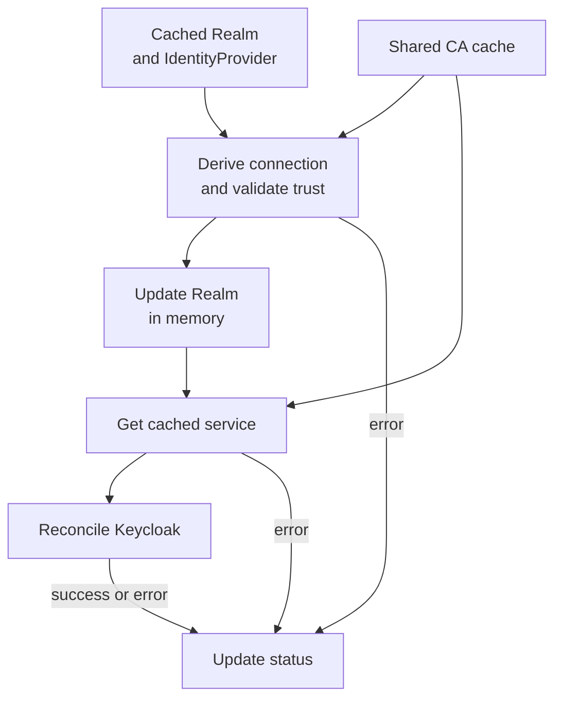

# Identity Domain

The Identity domain manages identity and access management for the Control Plane through Keycloak integration. It provisions identity providers, realms, and service-account clients in a declarative, Kubernetes-native way.

## Custom Resources

<CRDReference domain="identity" />

### Secret Rotation Support

When a Realm is configured with a `secretRotation` policy, the Identity domain provisions a Keycloak client-policy that enables graceful secret rotation for opted-in clients. During rotation:

1. The current secret is moved to a "rotated" slot in Keycloak
2. A new secret is set as the primary credential
3. Both secrets are accepted until the grace period expires

Individual clients can opt out via the `identity.cp.ei.telekom.de/disable-secret-rotation: "true"` annotation.

## Provider CA trust and Realm connection status

A Realm follows its IdentityProvider and records its endpoints, credential inputs and CA reference in status.
Secret references remain references; their values are resolved when connecting to Keycloak.

- **Connection lifecycle:** the factory uses the current Realm, without rereading it. Status persistence follows normal
  reconciliation, including failures; there is no early status commit or frozen target.
- **Client reuse:** one service per Realm is replaced when its endpoints, resolved credentials, Realm UID or CA
  fingerprint change. Each reconciliation acquires its service; replacement closes idle connections while in-flight
  requests finish. Token refresh lives as long as the manager, not the originating reconciliation.
- **Trust:** IdentityProvider `spec.tls` references a same-namespace ConfigMap labeled `cp.ei.telekom.de/provider-ca: "true"`.
  Trust checks and service acquisition share the CA cache, including bundle-origin validation: successes last one minute,
  failures five seconds. A failed refresh blocks reconciliation rather than reusing expired trust or falling back to
  system trust. Custom trust requires HTTPS.
- **Convergence:** Kubernetes reads are informer-cached. IdentityProvider changes enqueue Realms, and Realm changes enqueue
  Clients. CA changes wait for a later reconciliation after cache expiry; rotation is not immediate.
- **Deletion:** Realms and Clients use the Realm's recorded connection, without a live IdentityProvider or a ready Realm.
  No recorded connection means no remote cleanup; incomplete status or failed trust blocks cleanup. Retain the CA bundle
  until cleanup finishes.

:::caution Endpoint moves are not migrations
Old remote resources are left in place. A crash after a remote request but before status persistence can also leave
resources unrecorded. Client lookup checks the stored UID against `spec.clientId`; changing that ID selects or creates
another client, without renaming or deleting the old one.
:::

See [Private Provider CAs](../admin-journey/environments-and-zones.md#private-provider-cas) for rotation and cleanup,
and [Endpoint moves](../admin-journey/environments-and-zones.md#endpoint-moves-and-realm-connections) for migration guidance.

## Domain Interactions

- **Admin domain** — Zones define which identity provider to use.
- **Organization domain** — Team creation provisions identity clients.
- **Application domain** — Application creation provisions identity clients.
- **Event domain** — EventConfig provisioning creates identity clients for OAuth2 token exchange.
- **Secret Manager** — Resolves secret references before provisioning clients in Keycloak.

## Related Pages

- [Architecture: Gateway Domain](./gateway.mdx)
- [Architecture: Organization Domain](./organization.mdx)
