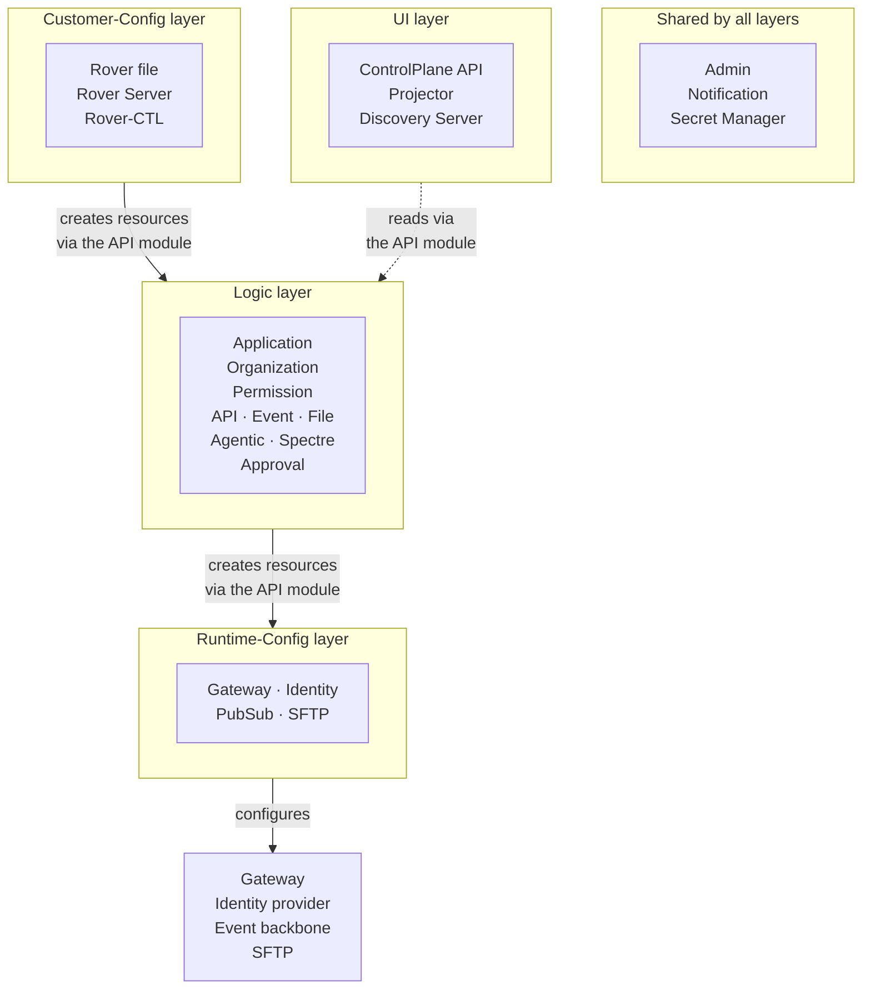

## Context

A customer describes what they want in a Rover file: APIs to expose, subscriptions, events, files. In the end, that wish has to become concrete settings on the components that carry the traffic, such as the API gateway, the identity provider and the event backbone. In between, the platform has to check the request, run approvals and resolve how the pieces depend on each other. Alongside, user interfaces need to see the resulting platform state without being able to change it.

## Decision

The Control Plane splits this path into three layers, and a request always moves through them in the same order. A fourth layer reads beside them, and a few services are shared by all.

- **Customer-Config layer.** The entry point for customers: the Rover file, Rover Server and Rover-CTL. It receives what the customer submits and does most of the validation, so that only well-formed requests travel further.
- **Logic layer.** The business rules: applications, organizations and permissions, API, event and file exposures and subscriptions, MCP servers, listeners, and approvals. It decides what the customer may get and resolves dependencies between domains.
- **Runtime-Config layer.** Turns the result into settings on the actual components: gateway routes and consumers, identity clients, publish and subscribe configuration, SFTP access.

Each layer hands over by creating resources that the next layer processes. A layer only sees the API module of the layer directly below it. It never skips a layer, never reaches into another domain's internals, and never looks upward. Domains within the same layer also talk to each other only through their API modules.

The UI layer, made up of the ControlPlane API, the Projector and the Discovery Server, sits next to the Customer-Config layer and follows the same rule: it sees only the Logic layer's API modules. It only reads. It never changes anything in the cluster, and no other layer depends on it, so the read side cannot leak into the business rules.

Administration, notifications and secret management sit outside the chain. They are shared by all domains in every layer.

## Options considered

- **Three layers, each seeing only the next layer's API module** (chosen): keeps the system modular, maintainable and easy to extend, and does most of the checking of customer input at the entry point.

No alternatives were evaluated. The layering was the initial design, and the team went with it.
