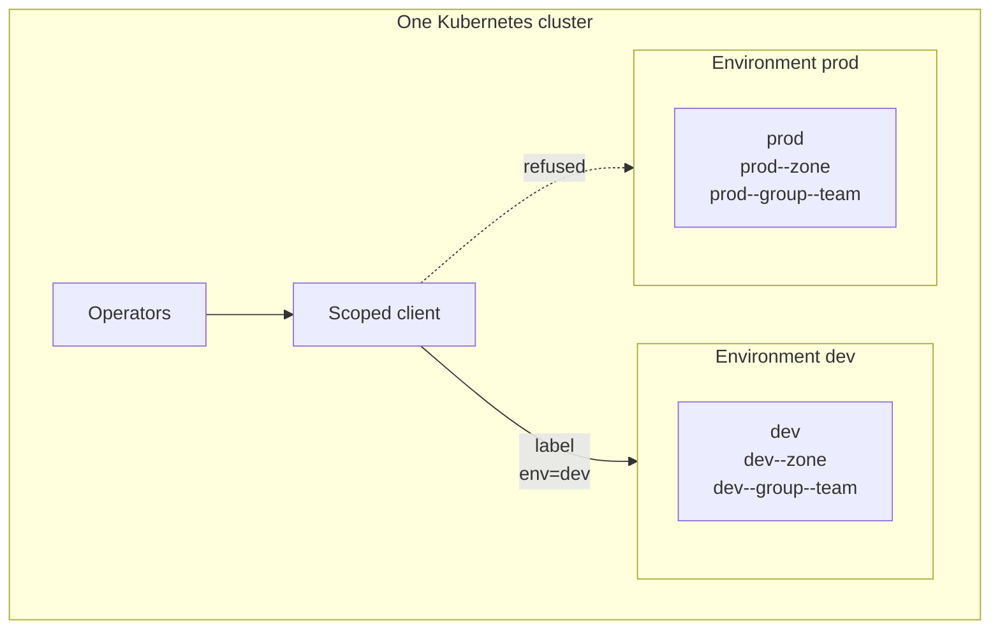

## Context

A Control Plane installation serves several environments, such as dev, staging and production. Each environment is a tenant: its zones, groups, teams and applications must never see or change those of another environment.

The goal was to run multiple Control Plane instances in a single Kubernetes cluster, because a separate cluster for each environment costs more. In one cluster, the same operators manage the resources of every environment. The environments are therefore isolated only virtually, by the Control Plane itself.

The platform also has to answer questions per environment, such as "list all Rover files in environment foo". Namespaces alone cannot answer that: a team's Rover files live in `foo--my-group--my-team`, not in `foo`.

## Decision

Environments are virtual. They share one cluster, and the Control Plane keeps them apart in its own code.

- **Every resource carries an environment label.** A resource without the label is blocked and not processed.
- **Operators go through a scoped client.** It stamps the label on every resource it writes. It only lists resources with the same label, and it refuses to read or delete a resource from another environment.
- **Namespaces carry the environment name.** Each environment owns a namespace named after it. Namespaces generated for it start with the environment: `<environment>--<zone>` for a zone and `<environment>--<group>--<team>` for a team.
- **REST servers take the environment from the caller's token.** Rover Server and Discovery Server read the `env` claim. They only return stored resources whose namespace starts with that environment.

Code that bypasses the scoped client must scope its own reads and writes. [Rule 13](https://github.com/telekom/controlplane/blob/main/.agents/rules/13-environment-isolation.md) checks this during review.

## Options considered

- **Virtual environments in one shared cluster, marked by a label** (chosen): one cluster costs less than one per environment. The label is convenient, and it finds every resource of an environment with a single lookup.
- **A separate cluster for each environment**: isolates environments without extra code, but lost on cost.
- **Namespaces only, without a label**: generated namespaces such as `foo--my-group--my-team` hide the environment in a name prefix. A lookup like "all Rover files in environment foo" would not be possible.

## Consequences

- A missing environment filter does not fail. It silently reads, enqueues or changes another environment's resources. Rule 13 therefore checks it at review time, as a critical finding.
- The cluster grows with every environment: each zone and each team adds a namespace and its gateway and identity resources.
- Components with their own storage must isolate environments themselves. By default, one ControlPlane API and one Projector serve all environments from one database. Separate pairs per environment are an operator's choice.
