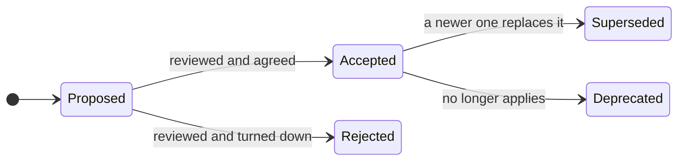

# Architecture Decisions

Some choices shape the Control Plane for years: how domains talk to each other, which gateway runs underneath, how tenants stay apart. The [architecture pages](../architecture/overview.md) describe how the system works. The records in this section explain why it works that way, which alternatives were weighed, and why they lost.

Each record captures one decision and stays short on purpose. It names the situation that forced a choice, the choice itself, and the options that were considered. Details of how something is built belong in the architecture pages, and a record links there instead of repeating them.

## Reading a record's status

Every record shows its status at the top of the page.

| Status | What it means for you |
| ------ | --------------------- |
| Proposed | A draft waiting for review. It may be incomplete or wrong, so do not rely on it yet. |
| Accepted | The team stands behind it. Changes in its area are expected to follow it, or to argue openly for revisiting it. |
| Rejected | An idea that was considered and turned down. It is kept so the same idea is not proposed again without new arguments. |
| Superseded | Replaced by a newer record, which is linked at the top of the page. |
| Deprecated | No longer applies, and nothing replaces it. |

Some records were written after the decision was made, reconstructed from documentation, history and the people involved. They are marked as reconstructed and list the sources they were drawn from, so you can check them.

## Changing a decision

A record is never rewritten to reflect a new direction. Instead, a new record supersedes the old one, so the history of why stays readable. Contributors check their changes against accepted records, and draft new ones, with the [review-architecture](https://github.com/telekom/controlplane/tree/main/.agents/skills/review-architecture) agent skill.
